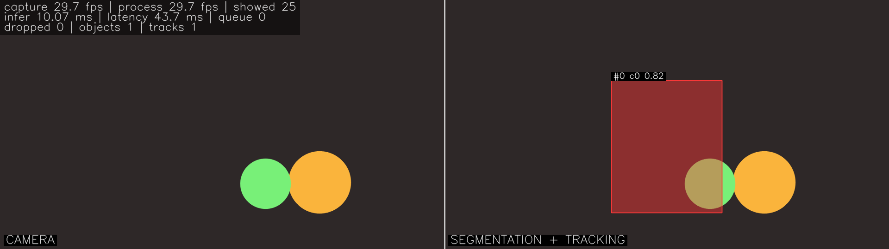

# videotest — камера → ONNX сегментация → трекинг → два потока рядом

Минимальный учебный проект: берём кадры с `/dev/videoX`, прогоняем через ONNX-модель instance-сегментации, ведём треки объектов и показываем **два потока рядом** — исходный кадр и тот же кадр с масками, боксами и `track_id`.

Цель — увидеть механику: V4L2, очередь между потоками, препроцессинг/постпроцессинг YOLO-seg, трекинг по IoU + Калман.



*(синтетический источник + модель-заглушка: бокс и маска — от заглушки)*

```
поток 1          Queue<FramePtr>(2)      поток 2                        Queue<ResultPtr>(2)
камера  ──────────────►  кадр  ──────────────►  модель → трекер  ──────────────►  main: рисует
+ poll/DQBUF             «старое вытесняется»                                  два потока + HUD
```

## Сборка

```bash
sudo apt install build-essential cmake libopencv-dev v4l-utils   # OpenCV 4.5+
./scripts/fetch_onnxruntime.sh                                   # SDK в third_party/
cmake -S . -B build -DCMAKE_BUILD_TYPE=Release && cmake --build build -j
ctest --test-dir build --output-on-failure                       # тесты трекера и очереди
```

Проверка без камеры и весов — `./scripts/smoke_test.sh`.

## Модель

Нужен YOLO*-seg в ONNX, например `yolo11n-seg.onnx` (экспорт: `yolo export model=yolo11n-seg.pt format=onnx`).

**Формат задаётся явно**, программа ничего не угадывает:

| `--out-layout` | Выход модели | Кто делает NMS |
|---|---|---|
| `raw` (по умолчанию) | `[1, 4+nc+32, N]` — YOLOv8-seg / YOLO11-seg | C++ (`suppress()`) |
| `nms` | `[1, N, 6+32]` — YOLO26 end-to-end | уже внутри графа |

Число классов тоже явное: `--classes 80`. Если формы не сойдутся, вы увидите это в логе (формы выходов печатаются при загрузке) и в предупреждениях, а не «пустую разметку непонятно почему».

## Запуск

```bash
# камера + модель
./build/videotest --model models/yolo11n-seg.onnx --classes 80

# MJPG 1280x720@30 по умолчанию; сырой YUYV — явно
./build/videotest --format YUYV --width 640 --height 480 --fps 30 --model models/yolo11n-seg.onnx

# без модели: разметка пустая, правая половина совпадает с левой
./build/videotest

# без камеры (отладка конвейера и трекера)
./build/videotest --synthetic --model build/stub-raw.onnx --classes 3

# без окна + снимок (сервер)
./build/videotest --synthetic --no-window --max-frames 60 --snapshot out.png
```

В окне: `q`/`Esc` — выход, `m` — маски, `b` — боксы.

HUD: `capture/process fps` (расходятся, если модель не успевает — это норма), `infer ms`, `latency` (от получения кадра до разметки), `dropped` (вытеснено очередью), `objects`, `tracks`.

## Как устроен трекер

`src/track/tracker.cpp`, принцип SORT, без лишних зависимостей:

1. **predict** — каждый трек сдвигает состояние `cv::KalmanFilter` (8 чисел: `cx,cy,w,h,vx,vy,vw,vh`, модель «равномерное движение»);
2. **associate** — для пар «детекция × трек» считается IoU, пары сортируются по убыванию и жадно сопоставляются (порог `iou_threshold = 0.3`);
3. **update** — найденный трек корректируется наблюдением и получает `track_id`, несопоставленные детекции создают новые треки;
4. **age** — трек без детекции стареет и удаляется после `max_age = 15` кадров.

Трекинг работает и без модели: детекций нет — трекер просто старит треки, ошибок не будет.

## Файлы

```
src/frame.hpp              Frame, Instance, Result — данные между потоками
src/bounded_queue.hpp      Queue<T>: ограниченная очередь, вытесняет старое
src/streams/               Source (интерфейс), V4l2Source, SyntheticSource
src/model/segmenter.*      ONNX: letterbox, декод raw/nms, NMS, маски
src/track/tracker.*        IoU + Калман
src/pipeline.*             два потока и очередь между ними
src/render/renderer.*      маски/боксы/подписи, склейка двух потоков, HUD
src/main.cpp               аргументы, сборка объектов, цикл отображения
tests/                     tracker_tests, queue_tests
scripts/                   fetch_onnxruntime.sh, make_stub_model.py, smoke_test.sh
docs/architecture.md       подробное объяснение механики (что и почему)
```

## Ограничения (сознательные)

* формат кадра и layout модели не подбираются: не подошло — программа скажет об этом;
* один объект модели, без батчинга;
* `cv::imshow` для показа (без окна — снимки и `--max-frames`);
* без модели нет и разметки — это и есть «пустые маски»: двух режимов не нужно.
